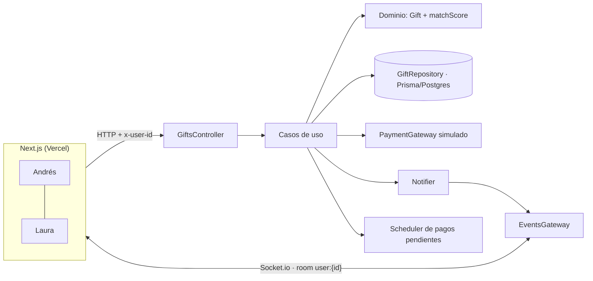
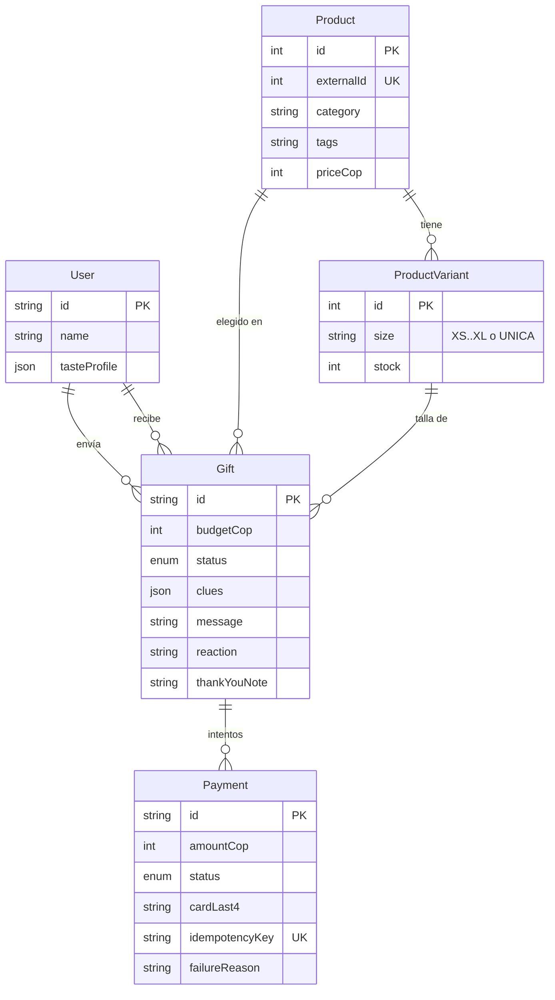

# Nido · Corazonada 🎁

**El regalo sorpresa con pistas.** Quien recibe participa en el regalo sin saber qué le van a regalar ni quién se lo regala.

Prueba técnica Full Stack para TANKU: NestJS + Prisma + Socket.io, Next.js (App Router) + Tailwind y PostgreSQL, en un monorepo pnpm.

---

## Demo

| | URL |
|---|---|
| Web (Vercel) | https://nido-ecommerce.vercel.app/ |
| API (Render) | https://nido-api-3hhd.onrender.com/health |
| Repositorio | https://github.com/EmanuelDesarrollo/nido-ecommerce |

**Cómo probarla:** abre la web en **dos pestañas**. En una entra como **Andrés** (quien regala) y en la otra como **Laura** (quien recibe). La sesión se guarda por pestaña, así que no hace falta una ventana de incógnito.

> La API usa el plan gratis de Render, que se duerme tras 15 minutos sin tráfico. La primera carga puede tardar unos 50 s; la pantalla de entrada muestra "Despertando el servidor…" mientras tanto.

---

## La idea y la métrica

**Problema.** El 35 % de las compras son regalos y el 22 % se devuelven. Quien regala adivina ("¿le gustará?", "¿qué talla usa?"), quien recibe no participa y la relación termina en el checkout.

**Solución: Corazonada.**

1. **Andrés** inicia una sorpresa para **Laura** con un presupuesto.
2. Laura recibe en tiempo real *"Alguien está preparando una sorpresa para ti 🎁"* y responde un mini juego de 4 tarjetas: qué le emociona, su estilo, su talla y qué **no** quiere. No ve productos ni sabe de quién viene.
3. Andrés ve llegar las pistas **en vivo**. El catálogo se filtra y se ordena con un puntaje **Corazonada %**, que combina gustos, talla disponible y presupuesto.
4. Andrés elige el producto (la talla ya viene con la pista de Laura), escribe un mensaje y paga en el checkout simulado. El resultado puede ser aprobado, rechazado o pendiente.
5. Laura recibe *"Tu sorpresa va en camino"* y **la destapa** con una animación de unboxing: ve el regalo, quién se lo dio y el mensaje. Reacciona con un emoji y una nota, y Andrés lo ve **en vivo**.
6. **Ciclo de recompra:** las pistas de Laura quedan como su **perfil de gustos** (la próxima vez el juego viene precargado), y tras destapar se le propone *"Devuélvele el gesto a Andrés"*.

**Métricas**

- **Principal: tasa de devolución.** Talla y gustos llegan informados. Meta: bajar del 22 % a menos del 12 % en regalos Corazonada.
- **Secundarias:** conversión de quien regala (menos abandono por no saber qué comprar) y recompra a 90 días (perfil de gustos reutilizable más el ciclo "devolver el gesto").
- **Medición:** A/B entre regalo normal y Corazonada, con los eventos `clues_requested`, `clues_answered`, `checkout_approved`, `revealed`, `thanked`, `return_requested` y `reciprocal_gift_created`.

---

## Arquitectura y decisiones técnicas

```
apps/api         NestJS + Prisma + Socket.io      → Render (Web Service + Render Postgres)
apps/web         Next.js App Router + Tailwind    → Vercel
packages/shared  tipos, DTOs, estados y eventos de socket (compilado con tsc)
```

Ambas apps importan de `@nido/shared` los estados, los nombres de eventos y los contratos de la API, de modo que no hay strings sueltos que se desincronicen entre front y back.



### Backend: Clean Architecture solo en el módulo core

`apps/api/src/gifts` está separado en capas:

| Capa | Contenido |
|---|---|
| `domain/` | `Gift` como máquina de estados con transiciones y permisos por rol, `matchScore` como función pura y errores de dominio. |
| `application/` | Puertos (`GiftRepository`, `PaymentGateway`, `Notifier`, `PendingPaymentScheduler`) y casos de uso (`CreateGift`, `AnswerClues`, `SkipClues`, `Checkout`, `ResolvePendingPayment`, `RevealGift`, `ThankGift`, `GetGifts`). Son clases sin decoradores de Nest. |
| `infrastructure/` | Repositorio Prisma, gateway de pago simulado, notifier por Socket.io y scheduler con `setTimeout`. |
| `presentation/` | Controller, DTOs con `class-validator`, presenter por rol y gateway de sockets. |

Los casos de uso se conectan a sus adaptadores con `useFactory` en `gifts.module.ts` y se prueban con un repositorio en memoria. `users` y `catalog` son controller + service + Prisma **a propósito**: no tienen reglas de negocio que justifiquen las capas.

**Máquina de estados.** Cualquier transición no permitida lanza `InvalidTransitionError`, que llega como HTTP **409**:

```
CLUES_REQUESTED ──(pistas de quien recibe / "seguir sin pistas" de quien regala)──▶ CLUES_ANSWERED
CLUES_ANSWERED | PAYMENT_REJECTED ──checkout──▶ PAID | PAYMENT_PENDING | PAYMENT_REJECTED
PAYMENT_PENDING ──resolución asíncrona──▶ PAID | PAYMENT_REJECTED
PAID ──destapar──▶ REVEALED ──agradecer──▶ THANKED
```

Los errores de dominio se traducen así: no encontrado → 404, sin permiso → 403, conflicto de estado → 409, regla de negocio → 422.

### Checkout simulado

- **Idempotencia.** El front genera un `Idempotency-Key` por intento de pago. Si llega un reintento con la misma clave, se devuelve el mismo pago sin cobrar de nuevo.
- **Montos del lado del servidor.** El backend calcula el monto desde la base de datos y nunca lo acepta del cliente: un campo `amountCop` en el body se rechaza con 400 (`forbidNonWhitelisted`). También valida presupuesto, stock y que la variante pertenezca al producto.
- **Validación de tarjeta.** 16 dígitos con algoritmo de Luhn, vencimiento `MM/YY` futuro y CVC de 3 dígitos. Solo se guardan los últimos 4 dígitos.
- **Stock transaccional.** Si el pago queda aprobado, el stock se descuenta **en la misma transacción** que el cambio de estado, con `UPDATE … WHERE stock > 0`.
- **Pagos pendientes.** Se resuelven tras `PENDING_PAYMENT_DELAY_MS` (6 s por defecto) con `ResolvePendingPayment`, que simula el webhook del procesador y es seguro llamarlo dos veces. Si el servidor se reinicia, los pagos que quedaron pendientes se reprograman al arrancar.
- **Un solo checkout a la vez.** No se permite pagar desde `PAYMENT_PENDING`; esto lo detectó un test, porque `PENDING → PAID` es una transición válida, pero solo para la resolución.
- **Privacidad de la sorpresa.** Quien recibe **nunca ve rechazos ni montos**: los estados de pago se le muestran como "se está preparando", y el remitente, el producto y el mensaje se ocultan hasta que destapa.

### Tiempo real

Cada socket se autentica con `auth.userId`, el servidor lo valida contra la base y lo une a la room `user:{id}`. Los eventos (`gift:clues_requested`, `gift:clues_answered`, `gift:payment_updated`, `gift:on_the_way`, `gift:revealed` y `gift:thanked`) llegan solo a la persona que corresponde. Al reconectar, el front recarga los datos para no perder eventos. Socket.io usa el mismo `CORS_ORIGIN` que HTTP.

### Frontend

- **App Router.** Los layouts y cada `page.tsx` son Server Components. Las pantallas con usuario, sockets o interacción son `'use client'` y van envueltas en `<Suspense>`, porque `cacheComponents` lo exige al usar `useParams`/`useSearchParams`.
- **Responsive.** Mobile first (diseñado a 375 px) y aprovecha el ancho en escritorio: bandeja en 2 columnas, catálogo de 3 a 4 columnas con panel lateral de pistas, y checkout en 2 columnas.
- **Estados.** Cada pantalla tiene estados de carga, vacío y error, además de `error.tsx` y `not-found.tsx` globales. Las imágenes usan `next/image` y los toasts en vivo, `sonner`.

### Identidad (sin login, por requerimiento)

Dos usuarios precargados y una pantalla "Entrar como…". La API valida el header `x-user-id` contra la base con `UserGuard` y responde 401 si no existe. En producción esto sería autenticación real (JWT o sesión).

### Seguridad

`helmet`, CORS restringido a `CORS_ORIGIN`, `ValidationPipe` global (`whitelist` + `forbidNonWhitelisted`), cero secretos en el repo (`.env.example` en cada app) y respuestas filtradas por rol. Un tercero que consulte una sorpresa ajena recibe 404 para no revelar que existe.

---

## Modelo de datos



- `User.tasteProfile` guarda las últimas pistas, como perfil de gustos reutilizable.
- `Payment` guarda `productId` y `variantId` para saber qué descontar al resolver un pago pendiente.
- El catálogo viene de DummyJSON (11 categorías mapeadas a moda, belleza, tecnología y hogar), con precios convertidos a COP. Si DummyJSON no responde, el seed usa `prisma/fallback-products.json`.
- El seed es idempotente y solo carga el catálogo si la tabla está vacía, para que los redeploys no reinicien el stock vendido.

---

## Cómo correr en local

Requisitos: Node ≥ 22.13, pnpm 11 (`corepack enable`) y Docker.

```bash
pnpm install
cp apps/api/.env.example apps/api/.env
cp apps/web/.env.example apps/web/.env.local
docker compose up -d                      # Postgres en el puerto 5433
pnpm --filter api prisma migrate dev
pnpm --filter api prisma db seed
pnpm dev                                  # API en :3001 y web en :3000
```

Abre http://localhost:3000 en dos pestañas, una como Andrés y otra como Laura.

| Comando | Qué hace |
|---|---|
| `pnpm dev` | shared + API + web en modo desarrollo |
| `pnpm build` | build de producción de todo |
| `pnpm test` | tests unitarios (Jest) |
| `pnpm smoke` | flujo completo contra la API (`API_URL=https://… pnpm smoke` para producción) |

**Despliegue.** Vercel (Root Directory `apps/web`) y Render (raíz del monorepo) despliegan solos al hacer push a `main`.

---

## Tarjetas de prueba

| Tarjeta | Resultado |
|---|---|
| `4242 4242 4242 4242` | ✅ Aprobada |
| `4000 0000 0000 0002` | ❌ Rechazada ("Fondos insuficientes"); se puede reintentar |
| `4000 0000 0000 3220` | ⏳ Pendiente; se aprueba sola a los ~6 s y ambos lo ven en vivo |
| Cualquier otra válida por Luhn | ✅ Aprobada |

Usa cualquier vencimiento futuro (por ejemplo `12/30`) y un CVC de 3 dígitos. En el checkout hay botones para cargar cada tarjeta de prueba.

---

## Tests

```bash
pnpm test     # 44 tests unitarios
pnpm smoke    # 46 verificaciones de punta a punta (HTTP + Socket.io)
```

- `gift.entity.spec.ts`: transiciones válidas e inválidas y permisos por rol.
- `match-score.spec.ts`: exclusiones (presupuesto, talla sin stock, categoría vetada), puntajes y orden.
- `checkout.use-case.spec.ts`, con repositorio y gateway en memoria:
  - un pago aprobado descuenta stock y notifica a ambos;
  - uno rechazado permite reintentar;
  - la idempotencia garantiza un solo pago por clave;
  - el monto sale de la base de datos;
  - un producto sobre el presupuesto, sin stock o desconocido da error;
  - un pago pendiente se resuelve una sola vez.
- `simulated-payment.gateway.spec.ts`: las 3 tarjetas.
- `card.validators.spec.ts`: Luhn y vencimiento.
- `scripts/smoke.mjs`: el flujo completo con las 3 tarjetas, permisos (401, 403, 404), validaciones (400, 409, 422), privacidad de quien recibe y cada evento de socket. Se corrió en local y contra producción.

---

## Lo que no alcancé y cómo lo haría

- **IA real para recomendar.** Embeddings del catálogo y del perfil de gustos, o un LLM que razone sobre ambos, en lugar de reglas fijas. `matchScore` ya está aislado detrás de una función pura, así que se reemplazaría sin tocar el resto.
- **Vaca grupal.** Varias personas pagan una misma Corazonada, con una barra de progreso en vivo. Implicaría pagos parciales por `Gift` y un estado `FUNDING`.
- **Regalar a alguien no registrado.** quien regala crea la sorpresa con solo el nombre del destinatario; el sistema genera un link mágico (token aleatorio hasheado, con expiración) que se comparte por WhatsApp; quien recibe responde las pistas y deja su dirección como invitado, sin registro; tras destapar se le invita a crear cuenta, vinculando su perfil de gustos.
- **Recordatorios de fechas especiales** usando los perfiles de gustos guardados.
- **Webhooks reales + cola (BullMQ)** para pagos pendientes. Hoy es un `setTimeout` en memoria, que se reprograma al reiniciar pero no sobrevive a varias instancias.
- **Auth real** (JWT o sesión) en lugar del selector de usuario.
- **Métricas de eventos** con un pipeline de analítica para medir el A/B descrito arriba.
- **Devoluciones** (`return_requested`), para cerrar el ciclo de la métrica principal.

---

## Uso de IA

Usé **Claude Code** como par de programación, por fases (ver [`AI_LOG.md`](AI_LOG.md) para el detalle):

- **Yo definí:** la idea, la métrica, el plan por fases ([`PLAN.md`](PLAN.md)), las reglas de trabajo ([`CLAUDE.md`](CLAUDE.md)), el cambio de Railway a Render, las reglas de frontend y la revisión del flujo y del diseño en local y en producción.
- **La IA generó:** el esqueleto del monorepo, el backend (dominio, casos de uso, adaptadores y tests), el frontend, el script de humo y este README como borrador.
- **Decisiones y correcciones relevantes:**
  - Se fijaron versiones estables: Nest 11, porque la 12 solo funciona con ESM; Prisma 6, porque `latest` era una RC; y TypeScript 5.9.
  - Se corrigió el orden de build (`prisma generate` antes de `nest build`).
  - Se usa Node 22 en Render, porque pnpm 11 lo exige.
  - Un test detectó un doble cobro posible con un pago pendiente, y se corrigió.
  - Se reescribieron hooks de React para cumplir las reglas de React 19 sin desactivarlas.
  - Se ajustó el layout para escritorio a pedido mío.